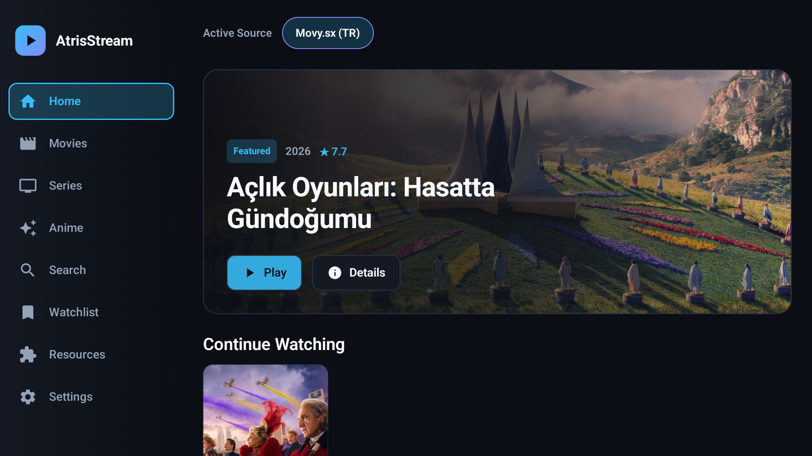
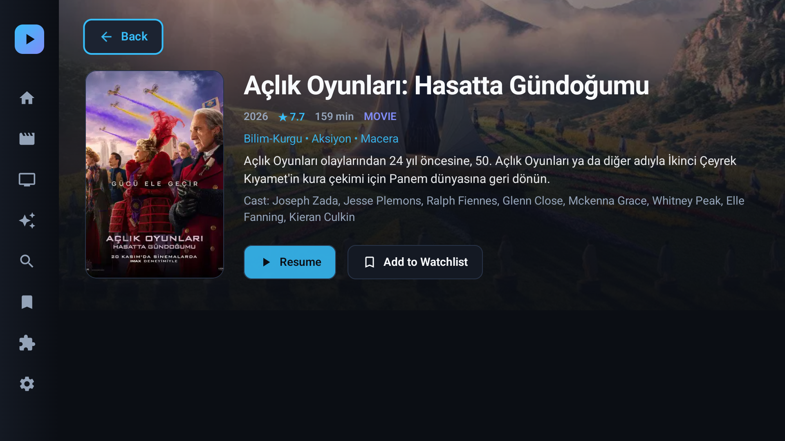
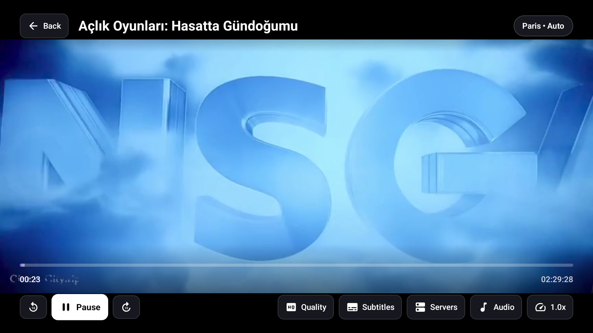
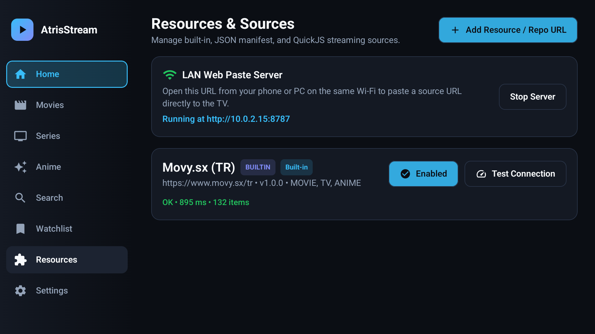

# AtrisStream

[](https://github.com/merteren97/AtrisStream/actions/workflows/android-ci.yml)
[](LICENSE)
[](https://developer.android.com/tv)

**AtrisStream**, Jetpack Compose for TV ve Media3 ExoPlayer ile geliştirilmiş; dahili sağlayıcıları, bildirimsel JSON manifestlerini ve izole QuickJS JavaScript eklentilerini destekleyen **Hibrit Dinamik Kaynak Motoru** ("Kaynaklar / Resources") özelliğine sahip açık kaynaklı bir Android TV / Google TV yayın oynatıcısıdır.

🇬🇧 [For English documentation, see README.md](README.md)

> **[AtrisHub](https://atrishub.com) tarafından desteklenmektedir** — Daha fazla geliştirici aracı, ürün ve proje için **[https://atrishub.com](https://atrishub.com)** adresini ziyaret edin.

---

## Özellikler

- **Doğal Android TV & Google TV Arayüzü**: Akıcı D-pad kumanda navigasyonu, TV ekranı ergonomisi ve Leanback başlatıcı desteği için `androidx.tv:tv-material` ve `androidx.tv:tv-foundation` ile geliştirilmiştir.
- **Media3 ExoPlayer Motoru**: Özel HTTP başlıkları (`Referer`, `Origin`, `User-Agent`) desteğiyle HLS (`.m3u8`), DASH (`.mpd`) ve MP4 akışlarını oynatır.
- **Kalite & Altyazı Kontrolleri**:
  - Oynatıcı içi sunucu ve kalite seçimi.
  - Harici altyazı URL'si ekleme destekli çoklu altyazı formatı (`.vtt`, `.srt`, `.ass`).
  - Özelleştirilebilir altyazı görünümü (yazı boyutu, renk, arka plan opaklığı).
- **Hibrit Dinamik Kaynak Motoru ("Kaynaklar / Resources")**:
  - **Dahili Sağlayıcı**: `movy.sx` varsayılan olarak yerleşik gelir (Film, Dizi, Anime).
  - **Bildirimsel JSON Manifestleri**: Kod yazmadan CSS seçicileri / JSON yol eşlemeleriyle yeni siteler ekleyin.
  - **QuickJS Korumalı JS Eklentileri**: Karmaşık siteler için hafif ve izole JavaScript eklentileri (`app.cash.quickjs`) çalıştırın.
  - **Depo İndeksi Desteği**: Tek bir `repo.json` bağlantısı üzerinden birden fazla kaynağı toplu olarak içe aktarın.
- **Yerel Veri Saklama**: İzleme geçmişi (kaldığın yerden devam et) ve izleme listesi için Room veritabanı; oynatıcı ve uygulama tercihleri için DataStore.

---

## Ekran Görüntüleri

| Ana Sayfa & Keşfet | Detaylar & Bölümler |
| :---: | :---: |
|  |  |

| Oynatıcı, Kalite & Altyazılar | Kaynaklar / Resources & LAN Yapıştırıcı |
| :---: | :---: |
|  |  |

---

## Mimari

AtrisStream, hafif kurucu tabanlı bağımlılık enjeksiyonu (`AppContainer`) kullanan modüler bir Gradle Kotlin DSL mimarisine sahiptir:

```text
AtrisStream/
├── app/                   # Android TV arayüzü, navigasyon, AppContainer DI, ViewModel'ler
├── core/
│   ├── model/             # Ortak alan modelleri ve MediaProvider arayüzü
│   ├── network/           # OkHttp istemcisi, çerez/başlık yardımcıları, HTTP araçları
│   ├── database/          # Room (WatchProgress, Watchlist, InstalledSource) ve DataStore
│   └── source-engine/     # MovyProvider, JsonManifestDriver, QuickJsDriver, SourceManager
├── feature/
│   └── player/            # Media3 ExoPlayer sarmalayıcı, kalite/altyazı seçimi, TV oynatıcı arayüzü
└── docs/
    └── source-templates/  # Örnek JSON manifest, JS eklentisi ve depo indeksi şablonları
```

---

## Dinamik Kaynaklar / Resources Formatı

Kullanıcılar uygulama içindeki **Kaynaklar / Resources** ekranından doğrudan harici kaynaklar veya kaynak depoları ekleyebilirler.

- **JSON Manifest Şablonu**: [`docs/source-templates/sample-json-source.json`](docs/source-templates/sample-json-source.json)
- **QuickJS Eklenti Şablonu**: [`docs/source-templates/sample-js-plugin.js`](docs/source-templates/sample-js-plugin.js)
- **Depo İndeksi Şablonu**: [`docs/source-templates/sample-repo.json`](docs/source-templates/sample-repo.json)

---

## Derleme Talimatları

### Gereksinimler
- **JDK 21** (örn. Eclipse Temurin 21)
- **Android SDK** (`compileSdk = 35`, `minSdk = 24`, `targetSdk = 35`)

### Derleme ve Test
```bash
# Birim testlerini çalıştır
./gradlew test

# Debug APK oluştur
./gradlew assembleDebug
```

Oluşturulan APK dosyası `app/build/outputs/apk/debug/app-debug.apk` konumunda yer alacaktır.

---

## Katkıda Bulunma

Katkılarınızı bekliyoruz! Kod katkıları ve harici kaynak eklentisi geliştirme kuralları için [CONTRIBUTING.md](CONTRIBUTING.md) dosyasını inceleyebilirsiniz.

---

## Lisans

Bu proje **MIT Lisansı** altında lisanslanmıştır — ayrıntılar için [LICENSE](LICENSE) dosyasına bakın.

**[AtrisHub](https://atrishub.com)** (`https://atrishub.com`) tarafından desteklenmektedir.
