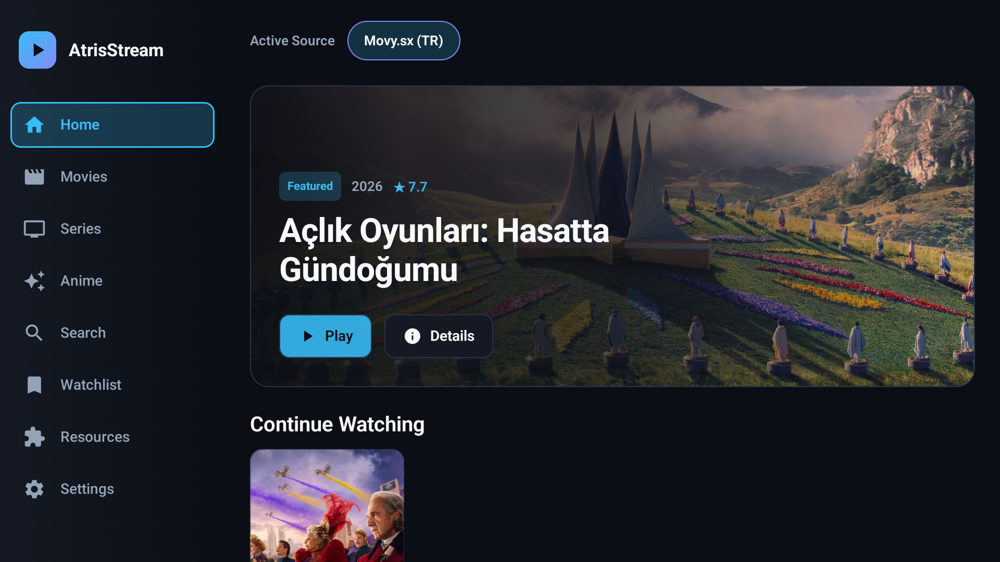
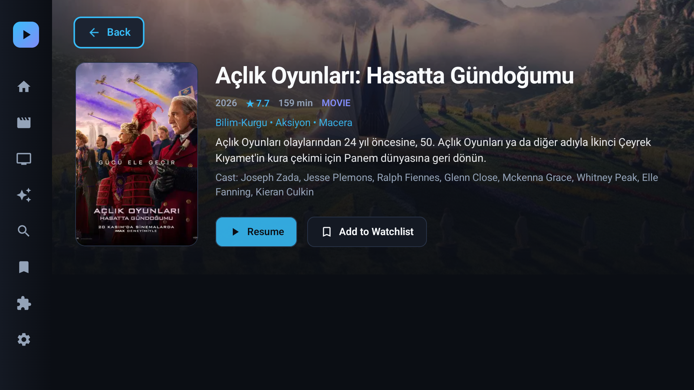
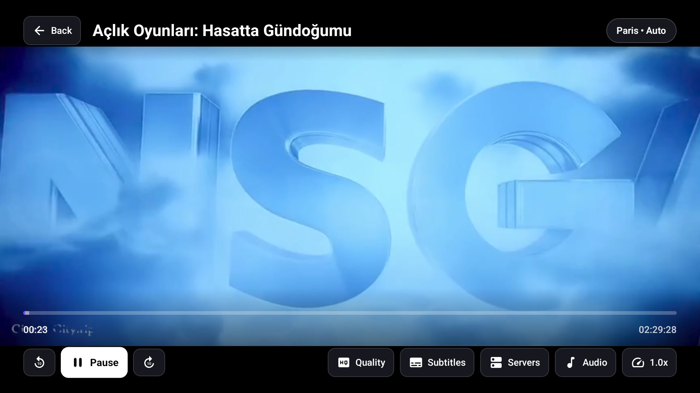
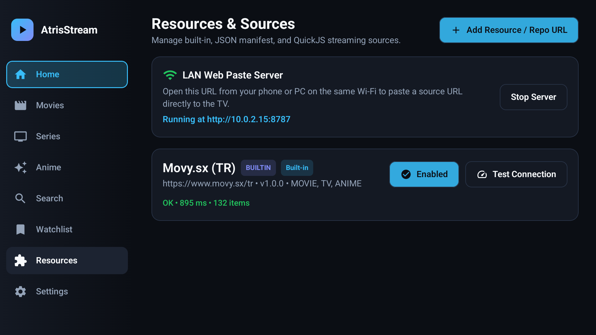

# AtrisStream

[](https://github.com/merteren97/AtrisStream/actions/workflows/android-ci.yml)
[](LICENSE)
[](https://developer.android.com/tv)

**AtrisStream** is an open-source Android TV / Google TV streaming player built with Jetpack Compose for TV and Media3 ExoPlayer, featuring a **Hybrid Dynamic Source Engine** ("Resources / Kaynaklar") supporting built-in providers, declarative JSON manifests, and sandboxed QuickJS JavaScript plugins.

🇹🇷 [Türkçe Dokümantasyon için README-TR.md dosyasına göz atın](README-TR.md)

> **Sponsored & Supported by [AtrisHub](https://atrishub.com)** — Explore more developer tools, products, and projects at **[https://atrishub.com](https://atrishub.com)**.

---

## Features

- **Android TV & Google TV Native UI**: Built with `androidx.tv:tv-material` and `androidx.tv:tv-foundation` for smooth D-pad navigation, 10-foot UI ergonomics, and Leanback launcher support.
- **Media3 ExoPlayer Engine**: Supports HLS (`.m3u8`), DASH (`.mpd`), and progressive MP4 streams with custom HTTP headers (`Referer`, `Origin`, `User-Agent`).
- **Quality & Subtitle Controls**:
  - In-player stream server & quality selector.
  - Multi-track subtitle support (`.vtt`, `.srt`, `.ass`) with external subtitle URL loading.
  - Customizable subtitle appearance (font size, text color, background opacity).
- **Hybrid Dynamic Source Engine ("Resources / Kaynaklar")**:
  - **Built-in Provider**: Ships with `movy.sx` out of the box (Movies, TV Series, Anime).
  - **Declarative JSON Manifests**: Add new sites without writing code using CSS selectors / JSON path mappings.
  - **QuickJS Sandboxed JS Plugins**: Run lightweight, isolated JavaScript plugins (`app.cash.quickjs`) for complex sites.
  - **Repository Index Support**: Import multiple sources at once from a `repo.json` URL.
- **Local Persistence**: Room database for watch progress (resume playback) and watchlist, plus DataStore for player & app preferences.

---

## Screenshots

| Home & Discover | Media Details & Episodes |
| :---: | :---: |
|  |  |

| Player, Quality & Subtitles | Resources / Kaynaklar & LAN Paste |
| :---: | :---: |
|  |  |

---

## Architecture

AtrisStream uses a clean multi-module Gradle Kotlin DSL architecture with lightweight constructor-based dependency injection (`AppContainer`):

```text
AtrisStream/
├── app/                   # Android TV UI, navigation, AppContainer DI, ViewModels
├── core/
│   ├── model/             # Shared domain models & MediaProvider contract
│   ├── network/           # OkHttp client, cookie/header helpers, HTTP utilities
│   ├── database/          # Room (WatchProgress, Watchlist, InstalledSource) & DataStore
│   └── source-engine/     # MovyProvider, JsonManifestDriver, QuickJsDriver, SourceManager
├── feature/
│   └── player/            # Media3 ExoPlayer wrapper, track selection, TV player overlay
└── docs/
    └── source-templates/  # Sample JSON manifest, JS plugin, and repo index templates
```

---

## Dynamic Resources / Kaynaklar Format

Users can add external sources or source repositories directly from the **Resources / Kaynaklar** screen in the app.

- **JSON Manifest Template**: [`docs/source-templates/sample-json-source.json`](docs/source-templates/sample-json-source.json)
- **QuickJS Plugin Template**: [`docs/source-templates/sample-js-plugin.js`](docs/source-templates/sample-js-plugin.js)
- **Repository Index Template**: [`docs/source-templates/sample-repo.json`](docs/source-templates/sample-repo.json)

---

## Build Instructions

### Prerequisites
- **JDK 21** (e.g., Eclipse Temurin 21)
- **Android SDK** (`compileSdk = 35`, `minSdk = 24`, `targetSdk = 35`)

### Build & Test
```bash
# Run unit tests
./gradlew test

# Build debug APK
./gradlew assembleDebug
```

The debug APK will be generated at `app/build/outputs/apk/debug/app-debug.apk`.

---

## Contributing

Contributions are welcome! Please read [CONTRIBUTING.md](CONTRIBUTING.md) for guidelines on code contributions and creating external source plugins.

---

## License

This project is licensed under the **MIT License** — see the [LICENSE](LICENSE) file for details.

Powered & supported by **[AtrisHub](https://atrishub.com)** (`https://atrishub.com`).
